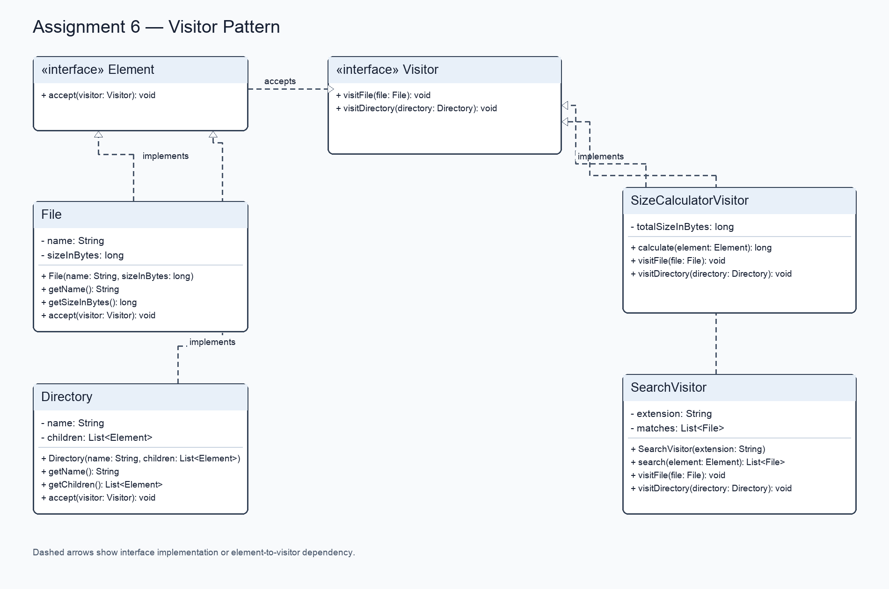

# Assignment 6 Report: Visitor Pattern

## Introduction

This project models a file system as a tree of `File` and `Directory` objects. The same structure is processed in two ways: `SizeCalculatorVisitor` totals the sizes of files throughout a directory tree, and `SearchVisitor` finds files by extension. Each element accepts a visitor and calls the operation for its concrete type, so the visitor and element type jointly select the operation through double dispatch.

## UML class diagram

The editable PlantUML source is [UML.puml](UML.puml), and its rendered class diagram is [UML.png](UML.png).



## Clean Code

1. **Meaningful names.** `SizeCalculatorVisitor.calculate` names the size operation and `SearchVisitor.search` names the search operation. `File.getSizeInBytes` includes the unit, which makes the value's meaning explicit.

2. **Double dispatch without manual type checks.** `File.accept` calls `visitor.visitFile(this)` and `Directory.accept` calls `visitor.visitDirectory(this)`. Both calls pass the concrete element to the matching visitor method. The visitors contain no `instanceof` chain or equivalent type switch.

3. **Single Responsibility Principle.** `SizeCalculatorVisitor` only accumulates byte sizes while traversing; `SearchVisitor` only filters file names by an extension. The immutable `File` and `Directory` classes represent data and implement visitor entry points without owning either operation.

4. **Encapsulation with the access needed by visitors.** Element state is private and final. Visitors read it through `getName`, `getSizeInBytes`, and `getChildren`; the directory returns an immutable list. This deliberately exposes the structural data required for operations while keeping callers from changing a file or directory after construction.

5. **Open for new operations.** A new operation can be added by implementing `Visitor` and defining `visitFile` and `visitDirectory`. `File` and `Directory` do not need changes for that new visitor. Adding a new element type, in contrast, requires adding a corresponding visitor method and updating existing visitors.

6. **Validate inputs at the boundary.** `File` rejects blank names and negative sizes, `Directory` rejects null child lists and null children through `List.copyOf`, and `SearchVisitor` requires an extension such as `.txt`. Null visitors and roots are also rejected.

7. **Avoid leaking mutable results.** `Directory.getChildren` exposes an immutable list, and `SearchVisitor.search` returns `List.copyOf(matches)`, so callers cannot change the model or visitor's internal results through a returned collection.

## Example output

The program was compiled and run from the repository root. It creates the same `project` tree for both visitors and prints:

```text
Total size of 'project': 10256 bytes
Files matching .txt:
- notes.txt (512 bytes)
```

## Encapsulation trade-off and conclusion

The visitor needs access to element data to perform work outside the element classes. This design uses narrow read-only accessors instead of public fields or mutable collections. It preserves encapsulation of state and allows new operations to be added without modifying `File` or `Directory`, while accepting that every new element type expands the `Visitor` interface and requires updates to each visitor implementation.

The repository demonstrates the Visitor pattern on a nested file system with two independent operations. Source code, run instructions, UML, and this report are available at [github.com/kaharn/assignment2-SPD](https://github.com/kaharn/assignment2-SPD).
